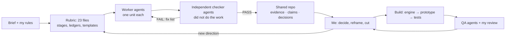

# AI Build Log · COD Remittance Recovery

**Gaurav Dabas** · Razorpay x ISB AI PM Build Challenge · Track 1 "Razorpay in Your Pocket"
**Prototype:** [dabasgaurav.github.io/cod-remittance-recovery](https://dabasgaurav.github.io/cod-remittance-recovery/) · **Code:** this repository

> **In one line:** I treated AI as a team I had to manage. Researchers, independent checkers, reviewers and an engineer all ran under written rules. The judgement calls stayed with me: which problem, for whom, what to cut, what to trust.

| | |
|---|---|
| **Time** | 11–13 Oct 2026, about 3 days |
| **Research files produced** | 252 stage files, 56 independent check reports, 323 sourced claim records |
| **Merchant voice analysed** | 3,915 Razorpay app reviews pulled; 2,517 coded line by line; a blind second coder agreed at Cohen's κ 0.91–0.97 |
| **Problems compared** | 30, on an 8-criterion framework with a policy gate |
| **Stress tests on the chosen solution** | 3 rounds × 8 independent reviewer agents, plus 4 build-feasibility reviewers |
| **Prototype** | a rules engine, 8 merchant situations and 20+ screens, every number computed live; end-to-end browser tests |

---

## 1. Tools and models

| Tool | What I used it for |
|---|---|
| **Claude (Anthropic), in the Claude app with agentic tools** | My lead assistant. It planned the work, spun up parallel sub-agents, and wrote and edited documents and code |
| **Claude sub-agents** (workers, checkers, reviewers) | Narrow, parallel jobs, each with its own brief: one research unit, one product teardown, one stress test |
| **A second, different model as a blind coder** | Re-coded a random 200 reviews without seeing the first labels, to test whether the coding was reliable |
| **Web search and fetch** | Razorpay docs and blogs, Shiprocket's help centre, support SOPs and SDKs, RBI directions, filings, news, seller reviews |
| **Browser automation** (Claude in Chrome / built-in browser) | Pulling public Play Store reviews; creating the GitHub repo and enabling GitHub Pages |
| **iPhone Mirroring + computer use** | Walking the live Razorpay merchant app screen by screen, so the prototype matches its real patterns (Home card, Settlements tab, settings rows) |
| **Python and Node in a sandbox** | Recomputing every number, building the synthetic dataset, generating PDFs |
| **Playwright** | Clicking through every screen in every situation and asserting the numbers shown on screen |
| **GitHub + GitHub Pages** | Version control and the public prototype |

**Not used:** no AI inside the product, no API keys in the repo, no real merchant data. The demo merchant, Papaearth, is synthetic.

---

## 2. How I set the AI up: an operating system, not a chat

What I read first: how strong PMs use AI. [Productside's guide to AI product-management workflows](https://productside.com/the-ai-product-management-workflows-2026/) comes down to five habits:
- keep persistent context;
- use repeatable workflows instead of one-off prompts;
- demand sources;
- verify outputs;
- keep human judgement on trade-offs.

I built the process around those ideas.

| Practice | How it worked here |
|---|---|
| **Persistent context** | Handoff files (`HANDOFF.md`, `STATUS.md`, `HANDOFF-COD.md`) let each new session start from the true state, not from memory. Two registers held everything the AI must not forget: a **decision register** (D-001…D-010) and a **corrections register** (COR-01…) |
| **Repeatable workflows** | Every worker got the same rules file and a stage rubric. Every finding needed an ID, a source URL, the source's date, the date accessed and a status tag (supported / reported / inferred / assumed) |
| **Maker ≠ checker** | Checker agents had not done the work they checked. They opened at least five cited sources and every source behind a decision-critical claim, marked each requirement Pass or Fail, and sent back a fix list. Up to two fix rounds; anything still failing became an open gap, written down |
| **Parallelism with a budget** | Research ran in waves of parallel agents, sized to the search limits we hit (about 200 searches per turn across all agents) |
| **Human gates** | I stopped the pipeline at set points ("stop before solutioning", D-008) to read everything myself before the next phase |

---

## 3. Key prompts and instructions

Excerpts that shaped the work, in my own words or from the rules files I set.

**Rules for every worker agent**
> "Nothing invented: no made-up sources, URLs, numbers, quotes, participants, features, winners or results. Every consequential claim carries a real source you opened and a status tag … A search snippet is only a lead: open and read the original page before relying on it."

**Rules for every checker agent**
> "You did NOT do the work you are checking … Open at least five cited sources, plus every source behind a decision-critical claim, and confirm each says what the claim says for the same population, date and scope."

**The reframe that changed the problem list** (D-010)
> "Think as senior PMs building a roadmap, not QA testers fixing friction … Before treating any gap as a product problem, ask: why hasn't Razorpay already done this? There is almost always a business, risk or regulatory reason."
> "App reviews are complaint-biased: use them only to corroborate, never to rank."

**Moving to a solution**
> "I don't understand how we are solving this problem really … let's do a rule-based thing."
> "Stress test this solution for gaps. I don't want unimplementable gaps to turn up at the time of prototyping."
> "I feel there are too many touchpoints right now."

**Building**
> "Don't just start making stuff up and start coding. Let's first discuss."
> "If it's starting with you clicking on the notification … this is just a video. A person should be able to open the app and see everything."
> "Stress test that there is no regression, and that whatever we change is consistent everywhere."

---

## 4. The workflow, stage by stage

| # | Stage | What AI did | What I did |
|---|---|---|---|
| 1 | **Brief and rubric** | Turned the brief into a case charter, a 23-file rubric and requirement ledgers | Set the scoring weights and what "Indian SME merchant" means (D-001, D-002) |
| 2 | **Company and portfolio** | Teardowns of Razorpay's app and products (8 units), competitors, company direction, past competition entries. Each was checked independently | Walked the live app on my phone with Claude watching; what we saw corrected the desk research (COR-21 to COR-27) |
| 3 | **Merchant voice** | Pulled 3,915 Razorpay app reviews plus rival reviews, coded 2,517 to 22 problems; a blind second model checked reliability (κ 0.91–0.97) | Decided reviews are complaint-biased: they illustrate, they never rank (D-010) |
| 4 | **Problem ranking** | Researched "why hasn't Razorpay done this?" for each problem; re-ranked 22 + 8 new problems on 8 criteria behind a policy gate | Dropped policy-bound problems (held settlements, KYC, settlement speed); chose the COD money chain as a new use case Razorpay doesn't own |
| 5 | **Deep dive: COD** | Six parallel research tracks: founder reality, the money chain, competitors, regulation, Razorpay building blocks, the bar to beat. Produced a 71,000-word master document | Narrowed from "COD Money Desk" (everything COD) to one job: get back the COD a courier owes |
| 6 | **Stress tests** | 3 rounds × 8 reviewer agents (name, problem, experience, AI/data, regulation, competition, business, judge), each recomputing every number in Python; editor agents applied the fixes | Settled each round's open decisions (R2-1…R2-13) |
| 7 | **Simplify to buildable** | 4 reviewers attacked the design for anything unimplementable; dug through Shiprocket's API, SDKs and report scheduler | Cut the touchpoints, cut Delhivery, chose email from the merchant's own account, removed AI from the product |
| 8 | **Prototype** | Wrote the rules engine, the synthetic dataset, 8 situations, the screens and the "behind the scenes" panel | Reviewed every screen against the user journey; sent back about 20 changes (see §5) |
| 9 | **QA** | Agents clicked every control across screens × situations × 5 screen sizes and reviewed every line of copy; Playwright asserts every number | Final calls on wording, order and what the judge sees first |
| 10 | **Submission** | Drafted the note, video script and this log | Rewrote the note's argument for Razorpay, not Shiprocket; chose the metrics; approved every claim |

---

## 5. AI outputs I rejected, corrected or significantly improved

### ★ The main one: I took AI out of the product

**What AI proposed.** The early design had a model reading each courier's remittance file and an agent preparing claims. The master document even named it in Razorpay's Agent Studio style ("Remittance Recovery Agent").

**Why I rejected it.** This job is arithmetic with one right answer, and the claim goes out in the founder's name to her courier. A model that reads files differently from week to week adds a new chance for a wrong number every time. If even one false claim goes out, the founder stops trusting the product.

**What replaced it.** A fixed, auditable rules engine:
- owed = order total − online advance, checked against Shiprocket's COD within ±₹1;
- due on the first Mon/Wed/Fri on or after 8 working days;
- claim only after Shiprocket's 10 working days, with two payouts received and no hold.

Every rupee on screen traces back to an order, a payout line or a wallet entry. AI stayed where it is strong: building, researching, reviewing.

### Other corrections

| AI output | What was wrong | What I changed |
|---|---|---|
| **Problems ranked by review counts** | Reviews over-represent merchants who lost money; counts measure anger, not size | Reviews corroborate only; a new 8-criterion ranking with a policy gate (D-010) |
| **A "RAY-proof" ordering of problems** | Let one existing feature steer the whole problem space | Withdrawn; RAY treated like any other existing capability (D-005) |
| **Weekly uploads of bank statements and wallet exports** | Too many touchpoints; no founder keeps that habit | Shiprocket's API plus its scheduled daily report: one setup, zero weekly effort |
| **A Home total that included Delhivery** | Counted money it had no data for | Rebuilt from Shiprocket data only; one courier proves the job |
| **"Only Razorpay knows what the courier should collect"** | The courier prints the COD amount on the label | Reframed: Razorpay's independent order record cross-checks Shiprocket's figure |
| **A hidden holiday bug** | Fri 2 Oct (Gandhi Jayanti) would have opened a false "payout on hold" | Holiday calendar in the rules; payouts shift to the next working day |
| **A prototype that opened on a notification** | It played like a video; you couldn't see how the feature is switched on | Setup comes first in the guide, with an ⓘ on each setup screen explaining why each input is needed |
| **Old orders vanishing two weeks later** | A rolling 30-day report replaced coverage, so unpaid orders silently left the claim | Coverage now accumulates like the payout ledger; nothing unpaid drops off |
| **Shipments counted higher than orders** | Prepaid parcels were included | Same COD orders counted on both sides |
| **Duplicate order IDs in one situation** | New demo orders reused existing numbers and showed "55 orders need a look" | IDs moved to a free range; caught by my screenshot review |
| **A "Claim all" that was all-or-nothing** | Founders often want to chase one order, or have already settled one | Tick boxes with a live total, "Claim only this order", and "Mark as resolved" with three reasons |
| **A one-pager written about Shiprocket** | It answered the brief but didn't argue why Razorpay should build it | Rebuilt around the merchant, why disputes are routine, and Razorpay's reasons to own it |
| **"₹ recovered per merchant" as the north star** | It rises when couriers pay worse | North star changed to the share of claimable COD recovered within 30 days |

---

## 6. What AI did vs what I decided or built

| AI did | I decided or did |
|---|---|
| Searched and read hundreds of sources, logging each claim with its source and status | Which problem: COD remittance, a new use case, over policy-bound problems |
| Coded 2,517 reviews; ran a blind reliability check | That reviews never rank anything |
| Ran parallel teardowns, deep dives and stress tests | When to stop and read; when to reframe the whole approach |
| Recomputed every number in code | Who it's for: founder-run brands on Magic Checkout who run the business from their phone |
| Drafted the 71,000-word master document and its four versions | What to cut: AI in the product, Delhivery, bank uploads, weight disputes, holding money |
| Wrote the rules engine, the dataset, the screens and the tests | The experience: setup first, one number on Home, the founder sends and Razorpay never does |
| Found Shiprocket's real claim route, report scheduler and API endpoints | The trust rules: never claim early, never claim during a hold |
| Created the repo and deployed Pages through the browser | The demo story, the brand (Papaearth), every word judges read |
| Ran QA across screens, situations and screen sizes | Final approval of every claim in every deliverable |

---

## 7. Known limitations, risks and how I verified the work

**Verification**
- **Numbers:** every figure is computed by one rules engine from one dataset: ₹4,69,810 owed, the ₹6,123 claim, and the Fri 9 Oct payout of ₹1,55,385 due against ₹1,49,390 paid. A Playwright test clicks through every screen in all 8 situations and asserts them on screen.
- **Sources:** checkers opened cited pages and confirmed each said what the claim said, for the same population, date and scope. Facts about Razorpay and Shiprocket come from their own docs and help pages, opened and read.
- **Regression:** after every change round, a full browser run plus a screenshot review of key screens.

**Limitations and risks**

| Limitation or risk | How we handle it |
|---|---|
| The demo data is synthetic | Built deterministically so every number reproduces; real data replaces it in a pilot |
| How often COD goes missing isn't published anywhere | The first test is a one-week data pull across Magic Checkout merchants with Shiprocket linked, then a 10-merchant pilot |
| Using the merchant's stored Shiprocket API user for remittance checks needs consent and partner agreement | Explicit consent screen; read-only scope; switchable off any time |
| Shiprocket can change report formats | Ledger is append-only and de-duplicated; a missing report pauses claims rather than guessing |
| AI-written research can carry wrong facts | Maker ≠ checker, source-opening rules, status tags, and a corrections register |
| Privacy | No personal identifiers recorded; no credentials in the repo; Razorpay never holds COD (RBI PA Master Direction 18(b)) |

---

*Every number in this log comes from the project files or the prototype. Nothing here is a credential, private data or proprietary material.*
