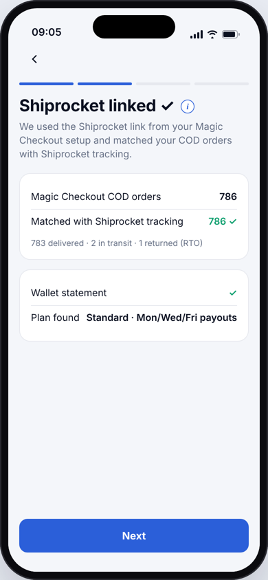
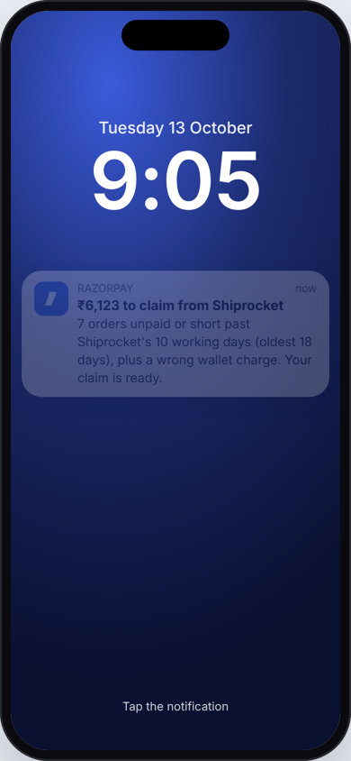
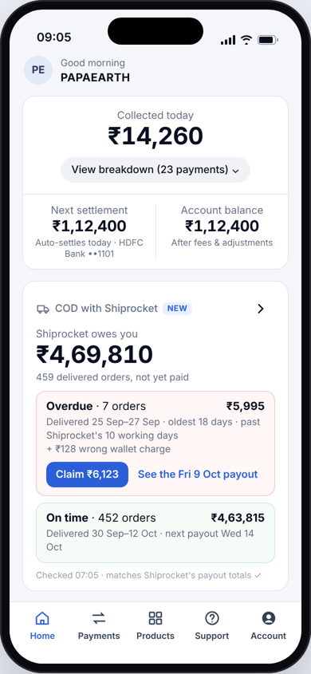
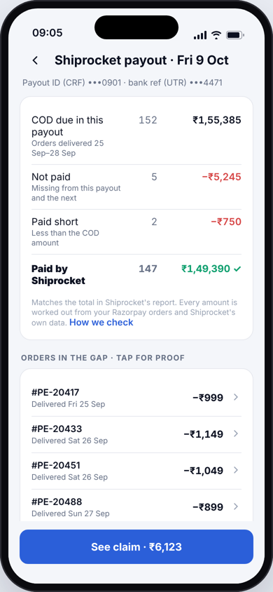
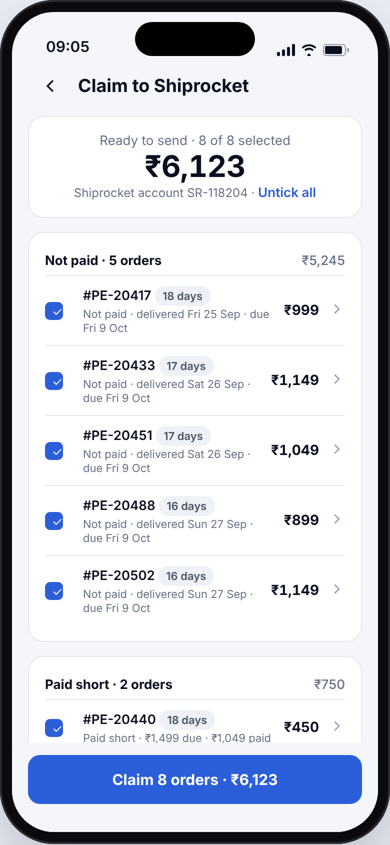
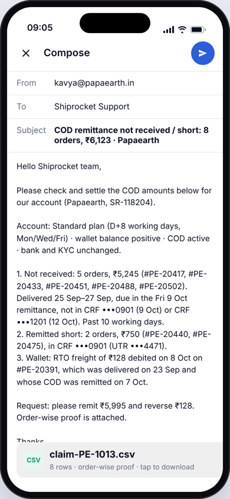
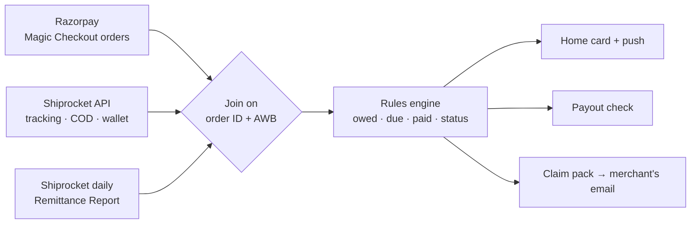

<div align="center">

# COD Remittance Recovery

### Couriers remit. Razorpay checks. You claim.

A Razorpay app feature that makes sure D2C founders get **every rupee of cash-on-delivery** their courier owes them.

**[▶ Open the live prototype](https://dabasgaurav.github.io/cod-remittance-recovery/)** · **[AI build log](BUILD-LOG.md)**

*Razorpay x ISB AI PM Build Challenge · Track 1 "Razorpay in Your Pocket" · Gaurav Dabas*

</div>

<p align="center">
  
  
  
  
  
  
</p>

---

## The problem

Kavya runs **Papaearth**, a D2C brand on Razorpay Magic Checkout. Half her orders are cash on delivery, shipped through Shiprocket.

- **Prepaid** money settles through Razorpay, itemised.
- **COD** money comes back days later in **one bulk transfer covering hundreds of orders**, net of wallet charges.
- If an order is missing, paid short or charged a wrong return fee, **nothing tells her**. Checking means a night in Excel matching remittance files to orders, so most founders never check.

## The solution

Razorpay already knows what each order should bring in. After every Shiprocket payout it checks each order against the merchant's own order record, and when money is missing it hands the founder a **ready claim with proof**, sent from her own email.

> **COD goes from Shiprocket to your bank. Razorpay never holds it.**

## The user flow

| | Step | What happens |
|---|---|---|
| **Setup, once (~2 min)** | 1 · Consent | Names exactly what is read: shipments, COD amounts, wallet statement |
| | 2 · Shiprocket linked | Reuses the Shiprocket API user the merchant already gave Magic Checkout; orders are matched with tracking |
| | 3 · Daily report | Shiprocket's Remittance Report is scheduled to a private Razorpay address; the screen confirms when the first one arrives |
| **The 2-minute job** | 4 · Push alert | Sent only when money is claimable: *"₹6,123 to claim from Shiprocket"* |
| | 5 · Home card | *"Shiprocket owes you ₹4,69,810"*: ₹4,63,815 on time, ₹5,995 overdue (7 orders) + a wrong ₹128 charge |
| | 6 · Payout check | Fri 9 Oct: ₹1,55,385 due, ₹1,49,390 paid. The gap is exactly 5 unpaid and 2 short orders |
| | 7 · Claim pack | Proof per order; untick any, claim just one, or mark it resolved |
| | 8 · Send | Opens in her own mail app with a CSV attached → "Claim sent" |
| **After** | Recovery | Reminder on Mon 19 Oct; orders are matched as recovered when they appear in a later payout |

---

## Try the prototype

**[dabasgaurav.github.io/cod-remittance-recovery](https://dabasgaurav.github.io/cod-remittance-recovery/)** works on desktop and mobile.

- **The phone (left)** is the Razorpay app. It opens on setup; finishing setup leads straight into the push alert. Tap any order, anywhere, to see its timeline.
- **The panel (right)** explains what's happening:

| Tab | What it shows |
|---|---|
| **Guide** | One-time setup and the 2-minute job side by side; click any step to jump there |
| **Situations** | Switch the merchant's situation; the rules engine re-runs and every screen updates |
| **Integration** | The two accounts, the two Shiprocket pipes (sample JSON and CSV), one order joined end to end, order states |
| **The check** | The 8-step algorithm, the terms used, and a live trace of the last order you tapped |
| **Data** | Live input counts, system architecture, payout lines, and the status of every order |

### The 8 situations

| Situation | What it proves |
|---|---|
| Money to claim | The main demo: ₹6,123 across 7 orders + 1 wallet charge |
| All paid | No alert when nothing is wrong |
| Late, not yet claimable | Never claims before Shiprocket's 10 working days |
| Payout on hold | Never claims while a payout may be held |
| Report not received | Pauses claims rather than guessing |
| Needs a look | Order and Shiprocket amounts disagree, so it is flagged, not claimed |
| Two weeks later, not claimed | Unpaid orders never drop off; the oldest are flagged by age |
| After recovery | Partial recovery: ₹5,373 of ₹6,123 paid, ₹750 still open |

---

## How it works



**The check, for every delivered COD order**
1. **Collect:** orders from Razorpay; tracking and wallet from the Shiprocket API; payout lines from the daily report.
2. **Join:** each order to its shipment, by order ID and AWB. Prepaid orders drop out.
3. **Owed:** order total − amount paid online before dispatch. It must match Shiprocket's COD amount within ₹1, or the order is flagged *Needs a look*.
4. **Due:** the first working Mon/Wed/Fri on or after 8 working days from delivery. Holidays move it to the next working day.
5. **Paid:** add up every payout line for the order. Lines are kept forever and de-duplicated on AWB + CRF.
6. **Status:** paid · on time · late · not paid · paid short.
7. **Claim guard:** only after Shiprocket's 10 working days, with two payouts received, report coverage complete and no payout on hold.
8. **Wallet:** return (RTO) freight on a delivered order is flagged as a wrong charge.

**Deliberately rule-based, with no AI in the product.** The job is arithmetic with one right answer, and the claim goes out in the founder's name. Every rupee on screen traces back to an order, a payout line or a wallet entry.

---

## What's in this repo

| File | What it does |
|---|---|
| [`engine.js`](engine.js) | The rules engine: owed, due date, ledger, holds, report coverage, wallet checks, claim totals |
| [`data.js`](data.js) | The synthetic Papaearth dataset (orders, shipments, payout lines, wallet, reports), seeded so every run is identical |
| [`scenarios.js`](scenarios.js) | The 8 situations, each built by changing the dataset, not the screens |
| [`app.js`](app.js) | The screens, navigation (with a real back stack), claim selection and resolve, and the side panel |
| [`index.html`](index.html) · [`styles.css`](styles.css) | The page and the Razorpay-style design |
| [`BUILD-LOG.md`](BUILD-LOG.md) | How AI was used to research, stress-test and build this |
| [`docs/`](docs) | Screenshots |

**Run locally:** no build step and no dependencies. Serve the folder and open it:

```bash
python3 -m http.server 8000   # then open http://localhost:8000
```

**Tested with:** Playwright end-to-end runs that click through every screen in all 8 situations and assert the key numbers on screen.

## Scope

**In:** Shiprocket (Standard plan), COD and partial-COD orders on Magic Checkout, missing and short payouts, wrong RTO charges, claims by email.

**Next:** Delhivery and other couriers · Shiprocket report by webhook · RazorpayX bank-credit confirmation · claims filed through Shiprocket's API.

**Never:** Razorpay holding, netting or advancing COD money, or sending anything without the merchant's tap.

---

<sub>All merchant data is synthetic. No credentials, API keys or personal data are stored in this repository.</sub>
